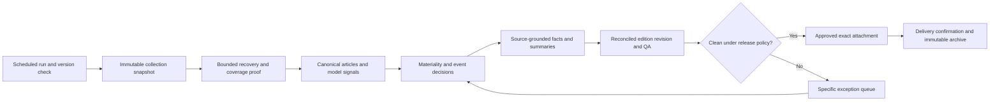

# News Scrap: technical reliability assessment

Assessment date: **28 October 2026, Asia/Colombo**. Based on the current local code, stored collection and model outputs, scheduler logs, and the corrected briefs in Downloads. Primary comparison: **Daily Financial Sector News Brief 2026-10-28.html**.

**Verdict: the project can produce a useful brief with intervention, but is not ready for unattended operation.** The repeated corrections have several independent causes: a broken scheduler contract, inconsistent release artifacts, excessive and occasionally incorrect editorial filtering, incomplete source recovery, and a summary generator that does not meet the standard of the corrected brief. Applying another coverage-path patch will not resolve them.

The practical target should be **unattended collection and transformation, automatic publication readiness for clean editions, and a small, explained exception queue**. An absolute guarantee that changing publisher websites and ambiguous stories will never require maintenance or review is not realistic. Routine code repairs and routine rewriting can, however, be substantially reduced.

This assessment makes no production code, approval, sent-history or scheduling changes. It supplies a concrete implementation specification and reproducible evidence. The existing test suite was executed; one existing test updates its synthetic `data/source_status/test_resume.json` fixture in the production directory, an isolation issue discussed below.

## 1. What was checked

- The October 28 downloaded brief, local named attachment, distributed archive, approved attachment, QA preview and their SHA-256 hashes.
- All 299 rows in the current integrated decision inventory; their source/date membership, model traces and editorial decisions.
- Seven current publisher status files and all seven coverage attestations.
- October 28 Stage 1, ML, corpus, taxonomy, completeness and source-flow outputs.
- Pipeline run summaries and scheduler failure alerts from October 15–28.
- Collection, scheduling, publication, deduplication, summary, coverage, sent-history and state-storage code.
- The existing offline test suite and an isolated replay of the current decision rules with and without today's editorial decisions.

The replay uses **current code against stored inputs**, not a reconstruction of every earlier code revision. It reproduces all 299 recorded final decisions when the current editorial CSV is supplied. No publisher-wide live crawl or model retraining was performed. The publisher statuses describe the recorded collection attempts, not present-time website health or proof of complete coverage.

## 2. Current data reconciles, but the output chain does not

| Layer | Observed result | Meaning |
|---|---:|---|
| Stage 1 / ML run | 173 articles each; SUCCESS | 123 published October 28 plus 50 October 27 late discoveries |
| Operational ML corpus | 22 KEEP; 151 NOISE | Reconciles to the 173-row run population |
| Taxonomy | 22 articles; SUCCESS | Classifies the operational KEEP population |
| Integrated inventory | 299 unique canonical URLs | 123 October 28 + 176 October 27 articles; includes earlier stored evidence |
| Model trace linkage | 299 of 299 | A trace is available; this does not establish classification correctness |
| Integrated final decisions | 270 EXCLUDE; 21 ALREADY_SENT; 8 INCLUDE | Every inventory row has one final decision |
| Human editorial file | 54 rows: 49 EXCLUDE, 5 INCLUDE | These decisions are reflected in the final trace |
| QA / candidate | 8 events; PASS / QA_PASS_NOT_DELIVERED | Validates the generated candidate |
| Downloaded and archived sent brief | 11 events | A materially different edition was distributed |

All 299 trace rows have nonempty URLs, headlines, publication dates and discovery/collection/publication timestamp fields. There are no duplicate canonical URLs in that inventory. These are good foundations. Timestamp accuracy and complete discovery are separate questions.

The 173 and 299 totals are **different populations**, not an unexplained duplication: the integrated inventory also uses earlier-date model evidence. Today's 173-row manifest includes 50 late discoveries whose actual `published_at` is October 27. The ML records' `publication_date` is the run date, so consumers must not treat it as the publisher's original date.

### Exact attachment identity

| Artifact | SHA-256 | Events |
|---|---|---:|
| Downloads, named attachment, alias and distributed archive | `3d64416793d14e2a2d1a8d7a9fbac9d52ccdfe2004ebf7cee70e641fe7431d75` | 11 |
| Current QA preview / independent QA record | `890a6367f690ca5fca8a68e3da6a1eff98f415bfbb8f06bc02e272bc6d3ffb4c` | 8 |
| Approved attachment / approval record | `3def69883c363b31037b553b9de92922bb4234afddd65aa471f2e7fdb492f2eb` | 8 |

The sent register correctly identifies the downloaded bytes. However, **the available PASS and approval records do not approve those sent bytes**. The report manifest still carries the QA preview hash while its final-attachment path contains the corrected sent file. It also retains legacy counts of 20 retained articles and 19 events, whereas the integrated candidate has 8 and the sent edition has 11. The earlier source-flow audit likewise describes the legacy output: 20 rendered URLs.

This is an artifact-lineage failure, not evidence that the corrected brief is necessarily inaccurate. Importing a sent file preserves distribution history; it does not retrospectively validate its content.

## 3. What changed in the brief you sent

Matching stories by canonical source URL, rather than headline wording, shows:

- All **8 candidate stories remain** in the sent brief.
- **All 8 summaries were rewritten**; the tax-policy headline was also changed.
- **3 additional stories** appear: ADB macro-recovery financing, the OPEC Fund loan, and apparel exports.
- The candidate has **8 source links**; the sent brief has **14**, including two extra APG references and the sources for the additional stories.

| Correction in sent brief | What the current pipeline did | Required durable change |
|---|---|---|
| ADB US$100m macro-recovery financing | Marked ALREADY_SENT | Strengthen event identity; incomplete old records must not justify semantic suppression |
| OPEC Fund US$60m loan | FT story was EXCLUDE / OUT_OF_SCOPE | Define sovereign/external financing materiality, including named development lenders |
| Additional Morning OPEC source | URL absent from the 299-row inventory; not found in the checked October 27–28 Morning staging or October 28 Stage 1/ML files | Record discovery paths and assess capture gaps; the FT source did capture the event |
| Apparel export detail | Explicitly excluded by signed decisions as already covered by the prior exports story | Resolve aggregate exports versus sector-specific releases in the editorial policy and correction history |
| APG supporting sources | FT and NewsFirst references were EXCLUDE / OUT_OF_SCOPE | Separate supporting event membership from the decision to display a separate story |
| Fuller summaries | Short extractive leads, sometimes incomplete | Fact-based summary generation and grammatical/factual output checks |

The apparel case matters: it is not just a missed keyword. The editorial CSV and the corrected delivered output disagree. Training on that CSV without reconciling the later correction would teach the system the opposite of the final preference.

## 4. Critical finding: the scheduled route is broken in two places

**Observed:** the October 28 08:30:05 task failed at 08:30:07, exit code 12, before collection. `config/production_freeze.json` is dated October 13. **9 of its 12 file hashes no longer match**. The alert folder contains **11 hash-failure alerts across 10 dates, October 15–28**, including two attempts on October 15.

Relevant code: `scripts/run_daily_news_task.ps1:131–152`.

There is a second blocker after the freeze check. Both scheduler implementations require report status `SUCCESS`; the integrated release writes `QA_PASS_NOT_DELIVERED` for a passing candidate. Executing the Python scheduler's validator against today's real output reproduced:

> Scheduler output gate failed: report manifest status is not SUCCESS

The PowerShell wrapper also expects `Report.metrics.all_phase2_article_count`, `stage_a_keep_article_count`, and `stage_a_noise_audit_count`. Today's report schema has no `metrics` object. Its assumption that the corpus KEEP count must equal the final publication population is no longer valid.

Relevant code: `scripts/run_scheduler.py:206–238`; `scripts/run_daily_news_task.ps1:219–260`.

**Fix:** use one versioned release-result contract in the pipeline and both scheduler entrypoints. Distinguish processing success, review required, approved, sent and failed. Validate current schema fields explicitly; never cast absent metrics to zero. Regenerate a production freeze only as part of a tested release, covering the actual builder, publication modules, configuration and model identities. The current freeze omits the new integrated-release modules and `build_financial_brief_v2.py`.

**Acceptance:** a clean fixture completes through the exact scheduled wrapper; a review fixture returns REVIEW_REQUIRED without a false crash alert; a real code mismatch still blocks; missing fields fail explicitly. Refreshing hashes alone is insufficient.

Windows Task Scheduler's live task inventory was access-denied during inspection. The recorded wrapper execution and failure are established by local logs; live trigger configuration remains unverified. The older `data/scheduler_status.json` belongs to the separate Python scheduler and must not be used as the sole status of the Windows task.

## 5. Critical finding: false duplicate suppression can remove material developments

The October 28 ADB macro-recovery article (`44-799234`) matched an older sent entry titled “ADB approves $100m to strengthen social protection and expand economic opportunities” (`44-798982`). That old entry contains **no publication date, summary, body or distributed-report path** in the loaded comparison record.

The comparison returned **one already-sent match and zero possible updates**. In `identity.same_event`, shared entities plus a common headline figure can be enough. In `reconcile.new_development`, a headline-only prior record returns false for an outcome comparison when it has no reported facts. Together, these rules turn inadequate historical evidence into a definitive ALREADY_SENT decision.

Relevant code: `src/bank_intel/publication/identity.py:287`; `reconcile.py:75–107`.

**Fix:** distinguish exact article duplicates, verified same events, related topics and possible updates. For loans, compare lender, borrower, named programme/purpose, financing components, event stage and date. Amount plus institution is insufficient. A prior record missing factual evidence should permit exact URL suppression but require review for semantic suppression. Preserve whether the event is lender approval, Cabinet approval, signing, effectiveness or disbursement.

**Acceptance:** the two ADB records must not silently collapse on their shared amount; true reprints still consolidate; later approvals/signings remain possible developments; old incomplete history creates a specific exception. Use the actual pair in `root_cause_evidence.json` as a regression fixture.

## 6. High finding: the current rules require substantial daily editorial input

The controlled replay produced:

| Decision | Without today's editorial CSV | With today's editorial CSV |
|---|---:|---:|
| INCLUDE | 3 | 8 |
| REVIEW | 53 | 0 |
| EXCLUDE | 222 | 270 |
| ALREADY_SENT | 21 | 21 |

The replay with decisions matches the recorded 299 decisions exactly. Without decisions, **53/299 = 17.7%** of the inventory needs review. Of those 53, 30 are FinBERT/rule conflicts, 11 are legacy inclusions requiring evidence, 4 infrastructure cases, 3 exploratory banking cases, 3 late-news cases and 2 macro cases. The 54-row editorial file includes one action that does not change its already-excluded status.

Five included stories depend on explicit human promotion from REVIEW: APG/AML, CRIB, capital-market budget measures, the CSE session, and conditional tax relief. This is not solved by lowering a single model threshold.

**Fix:** define one business materiality policy with positive and negative examples from the corrected outputs. Cover AML evaluations, credit-information infrastructure, sovereign financing, sector external receipts, fiscal policy stages, and routine promotional bank activity. Unify the legacy builder and integrated compiler's classification ownership. Maintain explicit `DISPLAY`, `SUPPORTING_SOURCE`, `EXCLUDE`, `POSSIBLE_UPDATE` roles so a corroborating source is not discarded merely because a separate card is unnecessary.

Corrections must enter a versioned decision/fact store with source evidence and supersession history. Reconcile the final 11-story edition with the earlier editorial CSV before reusing either as labels. Keep an untouched test period; do not train and score on the same corrected editions.

## 7. High finding: generated summaries are below the delivered standard

The current summarizer extracts lead sentences, has a 115-word ceiling, and stops once it reaches 48 words with at least two chunks. Its punctuation split treats some abbreviations as sentence boundaries.

The actual APG article reproduces a **53-word summary ending “Prime Minister Dr.”**. That output was present in the passing candidate. Other generated summaries mostly contain 49–76 words; the corresponding delivered summaries contain 113–138 words. Length alone is not the quality measure: the corrected version adds useful facts, attribution and distinctions between proposals and implemented action.

Relevant code: `src/bank_intel/publication/evidence.py:137–150`.

**Fix:** first implement abbreviation-aware segmentation and reject incomplete final clauses, bylines and repeated captions. Then generate a structured fact record: actor, action, date/period, amounts and units, status, attribution, implications and source spans. Build the summary from those facts with checks for numerical agreement, unsupported assertions, source disagreement and proposal/outcome distinctions. If a language model is introduced, constrain it to those facts and retain citations; replacing the current method with unconstrained generation would create a new failure mode.

**Acceptance:** no abbreviation-ending fragments; required material figures and periods retained; every summary claim traceable to source content; corrected summaries used as editorial references, not treated as independently verified truth. All eight rewrite cases should be in the regression review packet.

## 8. High finding: collection health and coverage exceptions are unresolved operationally

Latest recorded source evidence:

| Publisher | Health | Invalid extractions | Unresolved URLs | Other relevant evidence |
|---|---|---:|---:|---|
| Daily FT | PARTIAL_ERROR | 1 | 1 | 78-word People's Bank UAE item rejected |
| Daily Mirror | HEALTHY | 0 | 0 | Required surfaces recorded |
| Daily News | HEALTHY | 0 | 0 | Required surfaces recorded |
| The Morning | HEALTHY | 0 | 0 | Required surfaces recorded; one sent supporting URL absent from checked inventory/staging |
| The Island | PARTIAL_ERROR | 2 | 23 | 27 fetch failures; RSS fallback used; empty-body records and nonarticle links remain |
| NewsFirst | PARTIAL_ERROR | 4 | 4 | Latest pagination incomplete; rejected articles have 55, 67, 71 and 76 words |
| Ceylon Today | PARTIAL_ERROR | 1 | 1 | Finance HTML pagination incomplete; WordPress API marked complete; 79-word item rejected |

Counts are per publisher's current status contract. Fetch-failure counts can include repeated attempts and are not directly comparable with distinct unresolved URLs.

All seven coverage entries are VERIFIED, but **four depend on signed issue acceptances**. The path-identity fix in Downloads is already present: `prepare_coverage` resolves the root, uses a relative evidence label plus content hash, and preserves accepted issues for unchanged evidence. The existing relative/absolute-root regression test passes.

What remains:

1. **Minimum word count confuses short valid notices with extraction failures.** Use title/body alignment, publisher metadata, paragraph structure, short-notice types and evidence sufficiency. Do not simply lower all thresholds or exclude a failed page from its headline alone.
2. **Fallback success is not consistently reflected in coverage status.** Ceylon Today's API evidence reports 100 posts checked, a September 29 oldest date and complete pagination, while failed HTML archives still require manual acceptance. Prove that the API covers the required window and sections, then calculate coverage from that equivalence. WordPress exposes pagination totals and limits `per_page` to 100; a full first page alone is not proof of completion. [WordPress pagination documentation](https://developer.wordpress.org/rest-api/using-the-rest-api/pagination/)
3. **NewsFirst's eight-click cap is not a window-completeness proof.** Continue to an observed date boundary or verified terminal page with progress detection, budgets and explicit incomplete status.
4. **The Island mixes source outages, empty recovered articles and advertisement URLs.** Filter obvious nonarticle discovery links, persist per-URL attempt history, recover actual bodies where available, and keep unresolved material cases visible. RSS listing availability does not prove full-body recovery.
5. **Master retries stop on execution SUCCESS, even when coverage is partial.** Recover eligible failed URLs/surfaces rather than retrying entire healthy sources. The collection gate can stop before the later signed-exception mechanism is reached; resolve this inconsistency using a typed state contract.

The completeness manifest says PASS with zero recovered items, but its nine listing checks cover **only Daily FT and Daily Mirror**. That result must not be described as independent seven-publisher completeness. Surface names and HTTP 200 responses establish attempted access, not complete discovery.

## 9. High finding: publication and delivery need a single immutable lineage

The legacy builder creates final-looking files before integrated release. The integrated runner later moves them into a legacy folder, builds the governed edition, and republishes the send paths. If a failure occurs between those stages, an ungated legacy artifact can remain at a familiar attachment path. This is a code-path risk; the current sent artifact is separately archived.

The subsequent manual correction/import route records delivered bytes but leaves the candidate, approval, final inventory and report manifest representing earlier states. The October 28 sent record also lacks the actual `sent_at`; its state is `NOT_PROVIDED`. October 26 and 27 do have recorded send times.

**Fix:** use one edition ID and explicit revisions. Every revision contains its input snapshot, decisions, grouped events, facts, summary text, rendered bytes and QA hashes. Only validated, approved bytes become a sendable attachment. Any edit produces a new revision and reruns QA; it cannot inherit an earlier approval. Store the actual delivery timestamp, recipient-group identifier and delivery evidence where available. Never invent the missing October 28 time from a download or file-modification time.

Retain `publication_time`, `first_discovered_at`, `last_fetched_at`, `edition_cutoff` and `sent_at` as distinct fields. Late arrivals should enter the next eligible edition without modifying a sent edition. A rerun after sending should return an intentional already-sent/no-op state for publication, while allowing separate collection of later articles.

## 10. Medium-to-high finding: persistence and execution recovery need hardening

- `JsonArticleState.load()` catches any exception and silently loads an empty article map. A temporary corrupt JSON file reproduced this behavior. It can erase effective deduplication and first-discovery knowledge on subsequent saves. Quarantine malformed state, retain its bytes, alert and recover from a last-good snapshot or rebuild explicitly.
- JSON state replacement is atomic, which is useful, but it uses a shared `.tmp` name and no cross-entrypoint lock. The Windows wrapper has a mutex; manual Python execution and other entrypoints do not share that protection. Use a common run/source lock and unique temporary paths.
- Main `subprocess.run` calls have no stage deadline. Network-level timeouts do not guarantee a browser subprocess or an ML step will finish. Use stage budgets, recorded timeout outcomes and process-tree cleanup; Python provides a `timeout` argument and `TimeoutExpired`, with additional handling needed for descendant processes. [Python subprocess documentation](https://docs.python.org/3/library/subprocess.html)
- A run can mix mutable status files and outputs from separate attempts. Bind every consumed artifact to a run ID, source snapshot hash, configuration hash, model ID and publication window. Resume from completed compatible stages rather than rerunning the full pipeline for editorial changes.
- The SQLAlchemy database files and Alembic configuration are scaffolding, not an implemented load layer. Current persistence is file-based. A database migration can help transactional state and review history, but is not a prerequisite for correcting scheduler, identity and summary defects. First define the state and provenance contracts.

## 11. Model evidence and release engineering limits

`config/intelligence/ml.yaml` records Stage A final-test KEEP recall **0.75 on a 35-row test**, and Stage B relevant recall **0 on a 16-row test**. These are stored evaluation figures, not a new evaluation conducted here. Stage B is correctly configured as auxiliary rather than an automatic exclusion gate. Stage A also has provisional label provenance.

The 299-row trace contains 28 post-model suppressions and 8 promotions. These indicate policy interaction; they are not a measured model-error rate. Complete trace linkage and matching inference probabilities do not show that operational article choices match the user-approved brief.

**Fix:** reconcile reviewed labels, evaluate recent unseen editions, and measure material-story recall, avoidable review volume, false duplicate suppression, numerical-summary errors and corrections after approval. Keep provenance and inference-parity checks. Pin a tested dependency environment and model/tokenizer artifacts for releases; current broad requirement ranges are not a reproducible environment lock.

## 12. What passing tests establish—and what is missing

Command executed:

```powershell
.\.venv\Scripts\python.exe -m pytest -q --disable-warnings --tb=short
```

Result: **197 passed, 3 subtests passed in 40.77 seconds**. This is evidence that the existing tests pass in the current environment. It does not demonstrate a successful scheduled, unattended publication.

The additional probes reproduced scheduler rejection, unsupported ADB suppression, incomplete APG summary and silent state reset. The current test suite contains coverage-identity and publication-integrity regressions, but these specific end-to-end gaps remain.

Required additions:

| Test | Required behavior |
|---|---|
| Exact scheduler-wrapper contract | A valid integrated release is accepted; schema gaps are rejected explicitly |
| No-review edition | Complete valid evidence can reach readiness under the adopted automation policy |
| Editorial hold | Expected review is distinct from infrastructure failure |
| October 28 corrected-output replay | Decisions, supporting sources, summaries and final bytes agree; not just story count |
| ADB same-amount/different-purpose pair | No unsupported ALREADY_SENT suppression |
| Short legitimate notices / empty bodies | Valid short evidence is accepted; empty or unrelated evidence is rejected |
| API/RSS fallback coverage | Alternative surface must prove the same required scope before clearing failure |
| Sentence abbreviations and numerical facts | No truncated honorifics; values and periods survive summary generation |
| Interrupted stage and repeated run | Safe resume; no duplicate events or overwritten sent files |
| Concurrent scheduler/manual entry | Shared locking prevents state and artifact races |
| Corrupt state | Recoverable explicit failure; no silent empty reset |
| Missing actual send time | Precise exception; no fabricated timestamp |

One existing collector test writes its synthetic `test_resume` status into `data/source_status`, even though it uses fake network responses. Move all test artifacts into temporary roots and verify tests leave operational files unchanged. No claim is made that the other production source statuses were changed by this audit.

## 13. Recommended implementation order

| Order | Work package | Completion condition |
|---|---|---|
| 1 | Unify scheduler, pipeline and release contracts; make a tested production freeze | Scheduled wrapper accepts the current governed schema and distinguishes HOLD from failure |
| 2 | Revisioned edition lineage and final-byte checks | QA, approval, inventory, published path and sent archive identify the same revision |
| 3 | Correct duplicate/event identity and old-history handling | The ADB failure and genuine repeat/follow-up cases pass regression tests |
| 4 | Reconcile corrected briefs into policy and labels | No contradictory CSV/sent decisions; APG, CRIB, financing and sector-release examples behave as intended |
| 5 | Repair summaries and preserve supporting sources | Corrected-output comparisons pass factual and grammatical checks |
| 6 | Normalize source outcomes and automate bounded recovery | Healthy sources progress; material unresolved evidence alone blocks; alternative coverage is proven |
| 7 | Shared locks, stage deadlines, immutable snapshots and resume | Crash/retry/concurrency tests pass; completed work is reused safely |
| 8 | Validate in shadow operation, then enable automatic readiness | Representative live editions meet agreed quality criteria without code patches or routine rewriting |

Do not remove coverage checks, overwrite sent locks, accept every failed source, or force all model/rule conflicts to INCLUDE simply to produce a green run. Those actions hide defects rather than remove the need for correction.

The eventual flow should be:



## 14. Readiness criteria

Adopt these as proposed acceptance criteria, not claims already achieved:

- At least **10 consecutive scheduled business-day shadow runs**, including weekend carry-forward and representative late-arrival handling, without a code patch or routine attachment rewrite.
- All seven publishers have a fresh, scope-specific coverage result; incomplete material coverage cannot become PASS because a reviewer field exists.
- Every candidate has a final decision; every displayed fact and link maps back to the edition revision's evidence.
- Zero unsupported duplicate suppressions or numerical contradictions in the agreed reviewed evaluation set.
- Zero hash mismatches among QA, approval and the sendable attachment; no ungated final-looking file survives a failed build.
- Interrupted and duplicate runs are safe; delivery confirmation prevents repeat distribution and preserves the actual sent artifact.
- REVIEW_REQUIRED is a supported outcome with an actionable queue. The measured review rate declines without reducing material-news recall.

The 10-day window is an initial operational validation target, not a statistical guarantee of future reliability. Agree a materiality rubric and acceptable exception rate before enabling fully automatic approval. The current code explicitly requires human publisher verification even for healthy sources, so unattended readiness requires an intentional policy implementation as well as engineering repairs.

## 15. Evidence and reproduction

Files created for this assessment:

- [Snapshot evidence](snapshot_evidence.json): hashes, all story comparisons, source status summaries, coverage exceptions, decision replay, run history and sent timestamps.
- [Root-cause evidence](root_cause_evidence.json): the ADB comparison record, APG summary reproduction, scheduler validator result and corrupt-state probe.
- [Editorial decision changes](editorial_decision_changes.csv): the 53 decision changes caused by today's review file.
- [Snapshot analysis script](analyze_snapshot.py) and [root-cause probe](probe_root_causes.py).
- [Existing test-suite result](test_results.txt).

Reproduce from the project root:

```powershell
.\.venv\Scripts\python.exe review\etl_audit_20261028\analyze_snapshot.py
.\.venv\Scripts\python.exe review\etl_audit_20261028\probe_root_causes.py
```

Both scripts read production evidence and write only beside themselves. They do not collect news, run model inference, approve editions, send messages or modify publication history. Later source changes can change replay results; the recorded JSON is the evidence for this assessment.

Remaining verification limits: live scheduler configuration could not be read; no fresh seven-source discovery-completeness proof was attempted; model accuracy was not re-estimated; the 11 delivered stories were compared with stored evidence, not independently fact-checked against every live publisher. The missing October 28 send time must come from actual delivery evidence. These limits do not change the reproduced scheduler, lineage, deduplication and summary findings.
